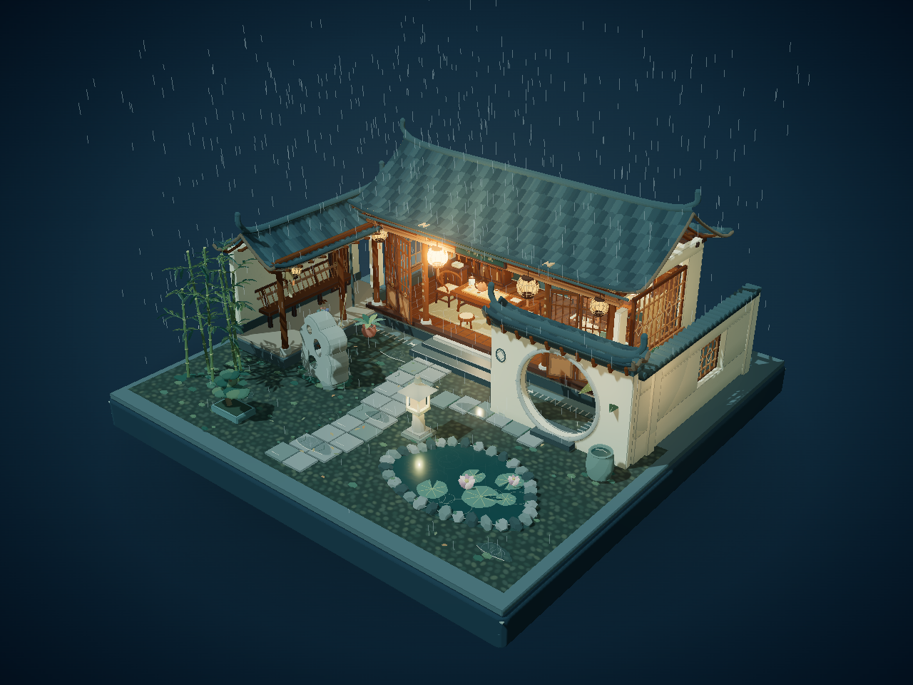
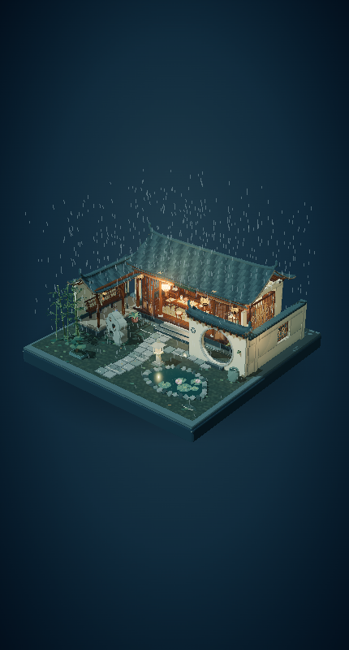

# 听雨小筑 · 雨夜中式庭院

**Rainy Jiangnan Courtyard** — 一个可以自由旋转、缩放、平移观看的中式雨夜微缩三维场景。白墙黛瓦、月洞门、回廊与暖亮茶室围合成一处紧凑的小院，全部景物位于完整的正方形底座上。

场景采用三渲二卡通材质、清晰轮廓线和冷暖灯光，画面只呈现场景本身，没有按钮、菜单、操作面板或人物。

查看竖屏预览

## 场景内容

- **江南建筑**：白墙黛瓦、翘角屋檐、木梁柱、敞开木格门窗、青石台阶、月洞门、漏窗、回廊与檐下灯笼。
- **庭院园林**：石板小径、卵石铺地、小型荷池、太湖石、石灯、竹丛、芭蕉、盆景、苔藓和生活道具。
- **温暖室内**：木质茶桌、紫砂壶与成套茶具、曲线圈椅、书案与笔墨纸砚、博古架、书籍与青花瓷、卷轴水墨画、软垫坐榻、屏风和宫灯。
- **雨夜细节**：细雨、檐滴、积水和池面涟漪、细微植物与灯笼摆动、缓缓上升的茶气，以及室内暖光与室外冷色的对照。

正屋采用**完整双坡黛瓦屋顶**，瓦片覆盖整个屋面，屋檐下保留清晰的梁柱与椽条。室内通过大面积敞开的木格门和透光窗观察；旋转至正屋前方并适当缩放，可以细看茶桌、书案与陈设。

## 模型与纹理

建筑、植物、家具、几何体和纹理均由 JavaScript 与 Canvas 程序生成，模型定义包含在 `src/` 源码中。水墨画、书法、木纹和其他细节也在运行时生成，无需下载外部图片、模型或字体资源。

本项目提供可编辑的 Three.js 源码和可直接打开的独立 HTML；没有单独的 `.glb`、`.gltf`、`.obj` 或 `.blend` 模型文件。雨水、反射、灯光与摆动由浏览器实时运行。

## 方式一：直接打开离线版

1. 下载整个项目 ZIP 并解压。
2. 找到根目录的 **`雨夜中式庭院.html`**。
3. 双击文件，使用 Chrome 或 Edge 打开。

离线版已经包含运行所需代码，**无需联网、无需安装 Node.js、无需启动服务器**。浏览器和显卡需要支持 WebGL 2。

在 GitHub 文件列表中点击 HTML 通常会看到文件内容；请先下载并解压，再在电脑上双击打开。若希望分享一个直接打开场景的网页链接，请使用下方的 GitHub Pages 部署方式。

## 操作

| 操作 | 效果 |
| --- | --- |
| 鼠标左键拖拽 | 旋转视角 |
| 鼠标滚轮 | 放大或缩小 |
| 鼠标右键拖拽 | 平移整个场景 |
| 双击画布 | 恢复初始观察位置 |
| 触屏单指拖拽 | 旋转视角 |
| 触屏双指操作 | 缩放和平移 |

初始视角为斜上方三分之四视角，展示完整庭院布局与建筑立面。旋转至正面并适当缩放，可透过敞开的木格门和透光窗观察室内细节。

## 方式二：修改源码与本地运行

### 安装环境

- Node.js **20.19+（20.x）或 22.12+**，推荐较新的 LTS 版本。
- pnpm **11.25.0**。

安装 Node.js 后，可在终端安装指定版本的 pnpm：

~~~sh
npm install --global pnpm@11.25.0
~~~

打开项目文件夹，在该文件夹中启动终端，执行：

~~~sh
pnpm install --frozen-lockfile
pnpm dev
~~~

首次安装依赖需要联网。浏览器打开终端显示的本地地址，通常为 `http://127.0.0.1:5173`。修改源码后，开发页面会自动更新。

### 构建、预览与打包

~~~sh
pnpm build
pnpm preview
~~~

`pnpm build` 会生成或更新：

| 位置 | 用途 |
| --- | --- |
| `dist/` | Vite 生产构建结果 |
| `雨夜中式庭院.html` | 可直接双击的独立离线版 |
| `docs/index.html` | GitHub Pages 网页版 |

`pnpm preview` 用于本地预览 `dist/`，请打开终端显示的预览地址。

准备上传 GitHub 时执行：

~~~sh
pnpm package
~~~

发布工具会整理生成：

- `release/GitHub上传文件-rainy-jiangnan-courtyard/`：可直接用于网页上传的干净文件夹。
- `release/rainy-jiangnan-courtyard-github.zip`：同一套发布文件的 ZIP 包。

**修改 `src/` 后，请重新运行 `pnpm build`，以同步更新离线版与 `docs/`；需要发布新的上传包时，再运行 `pnpm package`。**

源码入口 `index.html` 需要通过开发服务器或预览服务器打开；本地双击查看请使用 `雨夜中式庭院.html`。

## 发布到 GitHub

建议仓库名：**`rainy-jiangnan-courtyard`**。仓库需要由你在自己的 GitHub 账号中创建。

1. 在 GitHub 创建一个公开仓库，名称可使用上面的建议。
2. 创建时先不勾选自动添加 README、许可证或 .gitignore，使用本项目已准备的版本。
3. 在本地运行 `pnpm build` 和 `pnpm package`。
4. 打开 `release/GitHub上传文件-rainy-jiangnan-courtyard/`，进入文件夹内部。
5. 在 GitHub 仓库中选择 **uploading an existing file**，或 **Add file → Upload files**。
6. 将上传文件夹**里面的全部内容**拖入网页，保持 `src/`、`docs/`、`previews/`、`README.md`、`LICENSE` 等位于仓库根目录。
7. 等待上传列表出现，填写提交说明，例如 `Initial release`，点击 **Commit changes** 提交到 `main`。

上传目录已整理好发布内容。依赖目录 `node_modules/`、本地构建目录 `dist/`、Git 数据目录以及本地缓存都不需要上传。

### 如果网页提示 “This file is hidden”

`.gitignore` 以英文句点开头，某些上传操作可能将其当作隐藏文件过滤。可以直接在 GitHub 网页创建：

1. 打开仓库首页，选择 **Add file → Create new file**。
2. 文件名填写 **`.gitignore`**，保留开头的英文句点。
3. 用文本编辑器打开本地上传文件夹中的 `.gitignore`，复制其中的全部内容，粘贴到 GitHub 编辑框。
4. 点击 **Commit changes**，提交到 `main`。

确认仓库根目录里能看到 `.gitignore` 后即可。

## 开通 GitHub Pages 在线预览

上传完成后，仓库中应包含 `docs/index.html`。接着：

1. 打开仓库的 **Settings → Pages**。
2. 在 **Build and deployment** 中，将 **Source** 设为 **Deploy from a branch**。
3. 将分支设为 **main**，目录设为 **/docs**。
4. 点击 **Save**，等待 GitHub 完成部署。
5. 页面显示站点地址后，点击访问并测试拖拽、缩放；分享时使用该页面提供的最终网址。

网页版使用已经打包好的 `docs/index.html`，读者无需安装软件。之后更新场景时，重新构建并上传更新后的 `docs/` 即可。

## 分享作品

适合用 15～30 秒短视频展示整体旋转、室内近景、檐滴和荷池，再在小红书等平台的文案中附上：

- 作品名称与一两句场景介绍。
- GitHub 仓库地址，供读者下载源码。
- GitHub Pages 在线地址，供读者直接操作场景。
- GitHub 用户名与仓库名，方便通过搜索找到项目。

GitHub 仓库链接用于查看和下载文件；Pages 站点链接用于直接浏览交互场景。

## 主要文件

| 文件或目录 | 用途 |
| --- | --- |
| `src/` | 场景、建筑、室内、庭院、材质与动效源码 |
| `index.html` | 源码版入口 |
| `vite.config.js` | Vite 构建配置 |
| `package.json`、`pnpm-lock.yaml` | 命令、依赖与锁定版本 |
| `tools/` | 离线版构建与 GitHub 发布打包工具 |
| `雨夜中式庭院.html` | 独立离线版 |
| `docs/index.html` | GitHub Pages 网页入口 |
| `previews/` | 桌面与竖屏预览图 |
| `使用说明.txt` | 简明操作说明 |
| `LICENSE` | 本项目 MIT 许可证 |
| `THIRD_PARTY_NOTICES.md` | 第三方依赖的版权与许可声明 |

## 许可证

本项目采用 [MIT License](LICENSE)，版权为 **2026 peiningmao6-cpu**。允许使用、修改、再分发及商业用途；再分发时请保留许可证与版权声明。

Three.js、Vite 和其他第三方组件保留各自许可证，详见 [THIRD_PARTY_NOTICES.md](THIRD_PARTY_NOTICES.md)。离线版与网页版也附带所需的版权与许可声明。
